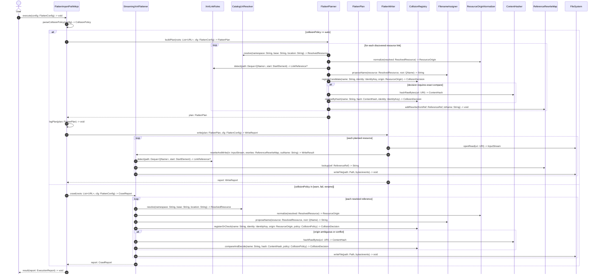

# Flatten File Collision Design Draft 1

## Context
This document is the implementation-oriented companion to the enhancement problem statement:
- [Flatten File Collision Enhancement](/Users/bertramn/workspaces/fares-io/oss/design-builder/docs/flatten-file-collision-enhancement.md)

It focuses on component interactions, call flow, and component responsibilities.

## Sequence Diagram

## Component Responsibilities
| Component | Type | Responsibility |
|---|---|---|
| `FlattenImportPathMojo` | Existing (change) | Parse collision config, select execution mode (`warn/fail/rename/auto`), orchestrate planner/writer or single-pass flattener, report summary. |
| `CatalogUriResolver` | Existing (change) | Resolve references and return structured resolver result (URI + method + trace + origin hints). |
| `ResolvedResource` | New | Resolver output model (`resolvedUri`, resolution method/trace, optional origin metadata). |
| `ResourceOrigin` | New | Canonical source-origin model for Tier-1 equivalence checks. |
| `ResourceOriginNormalizer` | New | Normalize resolver results into canonical `ResourceOrigin` values. |
| `StreamingXmlFlattener` | Existing (change) | Stream parse/rewrite, recurse resources, apply final filename mapping, preserve comments/whitespace events. |
| `XmlLinkRules` | Existing (newly introduced) | Detect import/include/href points and extract link references from XML start elements. |
| `FlattenPlanner` | New | Stage-1 graph discovery and collision planning for `auto` mode. |
| `FlattenPlan` | New | Final immutable plan: resource graph, filename assignment, rewrite mapping, diagnostics. |
| `FlattenWriter` | New | Stage-2 execution for `auto`: materialize files and rewrites exactly per plan. |
| `CollisionRegistry` | New | Track filename-to-identity/hash bindings and detect/enforce collisions by policy. |
| `CollisionPolicy` | New | Enum + behavior wiring for `warn`, `fail`, `rename`, `auto`. |
| `ContentHasher` | New | Compute raw-byte hashes (lazy/on-demand for Tier-2 exact checks). |
| `FilenameAssigner` | New | Provide readable base names and deterministic hash-suffix names for collision cases. |
| `ReferenceRewriteMap` | New | Store source-reference to final-filename rewrite targets. |
| `SimpleNameCrawlerListener` | Existing (change) | Maintain readable base filename proposal logic for flattened outputs. |
| `CollisionDiagnosticsFormatter` | New | Format collision and planning diagnostics for logs and errors. |
| `CollisionCatalogFixtures` | New (tests) | Test fixtures for ns1/ns2 same-name-different-content catalog scenarios. |
| `FlattenCollisionPolicyTests` | New (tests) | Verify `warn`, `fail`, `rename`, `auto` behavior and rewrite correctness. |
| `OriginVsHashComparisonTests` | New (tests) | Verify Tier-1 origin short-circuit and Tier-2 hash fallback correctness. |

## Notes
1. `auto` mode is designed for deterministic, zero-backtracking output decisions.
2. Default mode remains filename-preserving for non-collision resources.
3. Tier-1 origin comparison optimizes performance; Tier-2 hashing remains the correctness guard.
